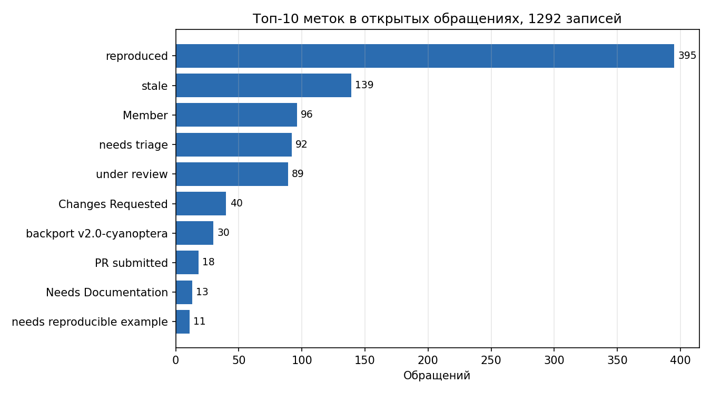
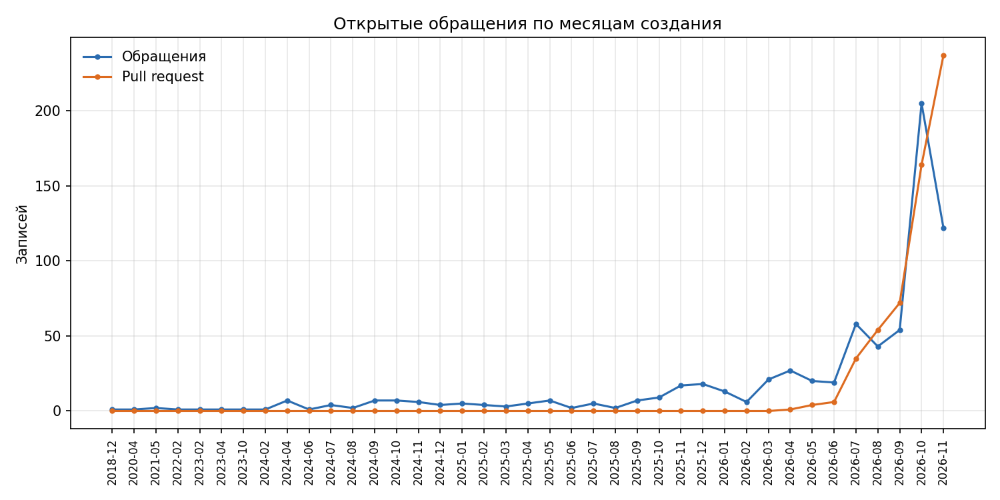

# Выгрузка из REST API с проверкой полноты

Учебный проект под вакансию «Аналитик данных» в сети общепита: регулярная
выгрузка обращений из внешней системы через API, контроль полноты и витрина
для дашборда. Логика переносится на любой источник с JSON и пагинацией —
iiko API, CRM, маркетплейс, служба поддержки.

## Проблема

Отчёт по обращениям собирают руками: копируют страницы из веб-интерфейса и
вставляют в Excel. Раз в месяц выясняется, что часть страниц потерялась, а
цифры не сходятся с источником. Никто не знает, сколько заявок на самом деле
и какие из них просрочены.

Нужно: воспроизводимая выгрузка, которая сама проверяет, что забрала всё,
и падает с ошибкой, если данных не хватает.

## Источник

GitHub REST API, открытые обращения репозитория `duckdb/duckdb`.

Почему не hh.ru: его API отдаёт `403` с этой сети независимо от
`User-Agent` — это видно в первом коммите проекта. GitHub выбран потому, что
на нём воспроизводятся все проблемные места реальных API: пагинация,
жёсткий лимит 60 запросов в час без токена, `403` вместо `429` при
исчерпании квоты, вложенный JSON и «лишние» сущности в выдаче.

## Стек

Python + requests (эталонный загрузчик), Power Query / M (рабочий путь в BI),
SQL (SQLite), Power BI, Git.

## Как запустить

```powershell
python api_fetch.py        # 13 запросов -> data/raw/issues.csv + лог
python sql/build_db.py     # витрины -> 11 проверок -> data/marts
```

Затем `power_query/README.md` — как собрать те же данные в Power BI.

## Результаты прогона (24.11.2026)

| Показатель | Значение |
|---|---|
| Открытых обращений по счётчику источника | 1 292 |
| Собрано строк | 1 292 |
| Запросов к API | 13 (лимит без токена — 60/час) |
| Время сбора | 34 с |
| Из них pull request'ов | 573 (44,3 %) |
| Обращений (без PR) | 719 |
| Без меток | 438 (33,9 %) |
| Период | 12.2018 — 11.2026 |
| Средний возраст открытого обращения | 122 дня |
| Старше 180 дней | 222 (17,2 %) |
| Среднее число комментариев | 1,81 |

## Как это выглядит





Графики строит `make_charts.py` из той же выгрузки, что грузится в Power BI —
чтобы результат был виден без установки BI.

## Проверки (11, все пройдены)

| Проверка | Что ловит |
|---|---|
| C1 Строк против счётчика источника | недогруженные страницы |
| C2 Дубли по номеру | повторную загрузку страницы |
| C3 Доля pull request | завышение метрик за счёт PR |
| C4 Закрытые даты у открытых | рассогласование статусов |
| C5 Пустая дата создания | строки без возраста |
| C6 Даты в будущем | сдвиг часовых поясов |
| C7 Покрытие периодами | дыры в истории |
| C8 Обращения без меток | неполную разметку |
| C9 Страниц в логе | стоимость обновления по квоте |
| C10 Пустые страницы | обрыв пагинации |
| C11 Топ-метка | sanity-check распределения |

Если хотя бы одна проверка даёт `FAIL`, `build_db.py` завершается с ошибкой:
отчёт не публикуется. Это главная идея проекта — «тихий» пустой отчёт хуже
упавшего.

## Что показал анализ

1. **Почти половина выгрузки — не обращения.** 44,3 % записей в `/issues` —
   pull request'ы. Если считать метрики по сырой выдаче, нагрузка на поддержку
   завышается почти вдвое. Флаг `is_pull_request` обязателен.
2. **Треть обращений без меток.** 33,9 % — фильтры по меткам теряют треть
   данных, а «топ меток» описывает не поток, а то, что успели разметить.
3. **Накопленный хвост.** 17,2 % открытых обращений старше 180 дней, самое
   старое — 2 910 дней. Средний возраст 122 дня говорит не о скорости работы,
   а о том, что старые заявки не закрывают.
4. **Разметка смещена к одной метке.** `reproduced` — 395 из 1 292 (31 %),
   дальше `stale` (139) и `needs triage` (92). Это удобная точка входа для
   разбора: треть потока — воспроизводимые дефекты.

## Дашборд: что показать

| Визуал | Поле |
|---|---|
| Карточки | всего обращений (без PR), доля PR, доля без меток, средний возраст |
| Гистограмма | топ-10 меток (`mart_label`) |
| Линия | обращения по месяцам с разделением issue / PR (`mart_month`) |
| Гистограмма | возрастные корзины: 0–30, 31–90, 91–180, 180+ дней |
| Таблица | авторы: обращения, PR, признак бота (`mart_author`) |
| Таблица | `log_data_quality`: проверка, факт, статус |

Скриншоты — в `screenshots/`, экспорт — `dashboard.pdf`.

## Ограничения

- Один срез на дату: выгрузка не хранит историю, поэтому «было/стало»
  считается только повторными запусками. Для полноценного SLA нужен слой
  истории (snapshot по дням) — это следующий шаг, а не сделанная часть.
- GitHub без токена: 60 запросов в час. Для репозитория крупнее ~6 000
  обращений нужен токен, иначе упираемся в квоту.
- Power Query-версия не запускалась: Power BI на машине нет, M-код вычитан,
  но первый прогон будет за тобой. Эталон — Python-загрузчик, его цифры
  считаются правильными.
- Метки — свободный текст, поэтому `needs triage` и `Needs Triage` могут
  оказаться разными метками. Регистр не нормализован намеренно: это видно
  в `mart_label` и разбирается на стороне бизнеса.

## Как рассказать за 2–3 минуты

1. Задача: отчёт по обращениям собирали руками, цифры не сходились.
2. Что сделал: загрузчик с пагинацией по `Link`, ретраями и обработкой
   исчерпанной квоты; лог каждой страницы; 11 проверок; витрины и дашборд.
3. Главная находка: 44 % выдачи — PR, а треть обращений без меток, поэтому
   любой отчёт «по сырому API» врёт.
4. Как проверял: число строк сошлось со счётчиком источника (1 292 = 1 292),
   пустых страниц нет, дублей нет.
5. Что дальше: слой истории по дням, чтобы считать SLA, и токен для
   репозиториев крупнее.

## Строка в резюме

«Настроил загрузку из REST API в Power Query: пагинация, обработка лимита
запросов, разбор вложенного JSON, 11 проверок полноты; расхождение с
источником — 0 строк на 1 292».
