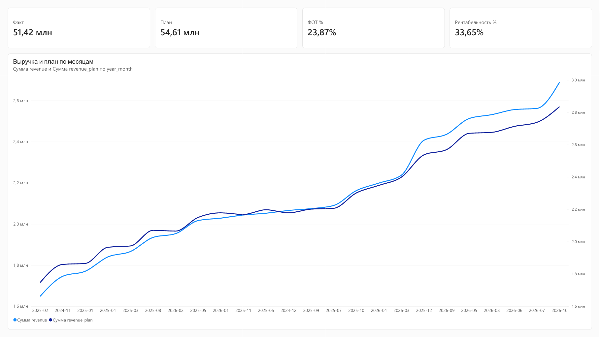
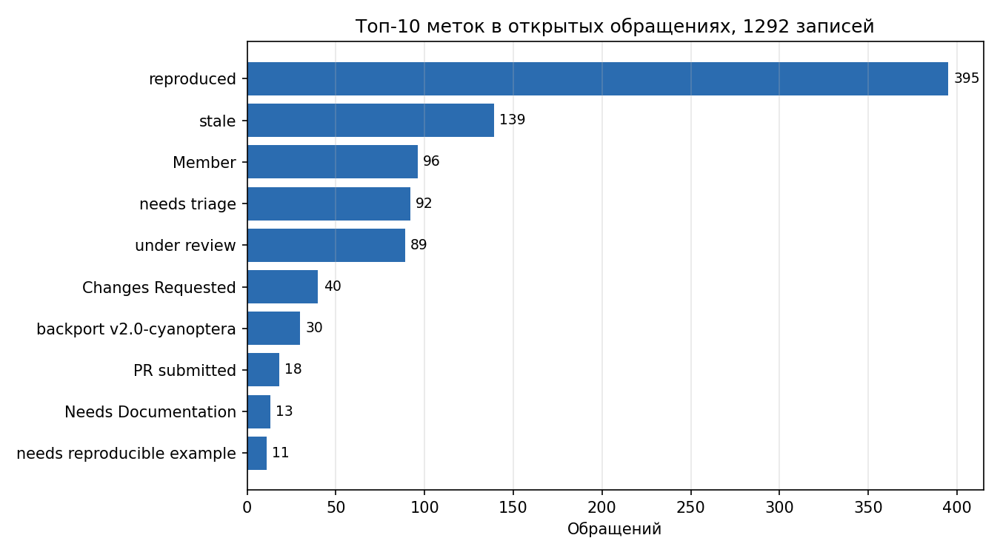
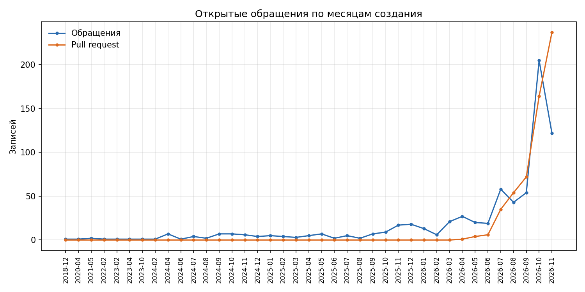

# Портфолио аналитика данных

Два учебных проекта под вакансии Junior-аналитика в ритейле и общепите.
Оба воспроизводимы двумя командами и содержат проверки качества данных,
а не только готовые графики.

| Проект | Что показывает | Стек |
|---|---|---|
| [01-iiko-pnl-dashboard](01-iiko-pnl-dashboard) | План-факт P&L сети из 10 точек: управленческая отчётность, разбор отклонений | SQL, Power BI, DAX, Power Query, Python |
| [02-api-pipeline](02-api-pipeline) | Выгрузка из REST API с пагинацией и 11 проверками полноты | Power Query (M), Python, SQL |

## Как смотреть

- `README.md` внутри каждого проекта — задача, правила расчёта, результаты, ограничения.
- `screenshots/` — страницы дашбордов (PDF-экспорт и PNG).
- Данные синтетические или открытые, это указано в каждом README.

## Результаты в картинках

Дашборд план-факт P&L сети (10 точек, 24 месяца, 238 882 строки):



Выгрузка из REST API (1 292 записи, 11 проверок полноты):




## Быстрый старт

```powershell
# проект 1
cd 01-iiko-pnl-dashboard
python data_gen/generate_data.py
python sql/build_db.py

# проект 2
cd ../02-api-pipeline
python api_fetch.py
python sql/build_db.py
```

Требуется Python 3.10+ с pandas и requests. Для дашбордов — Power BI Desktop.
